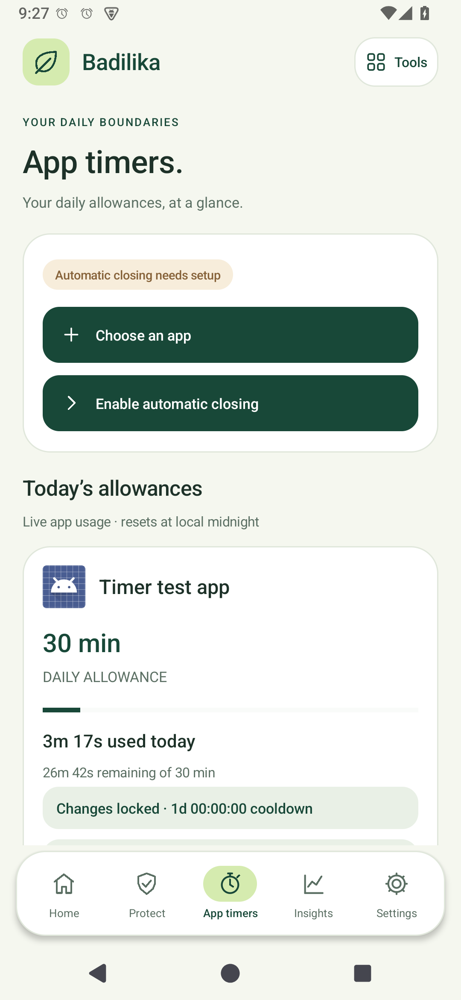
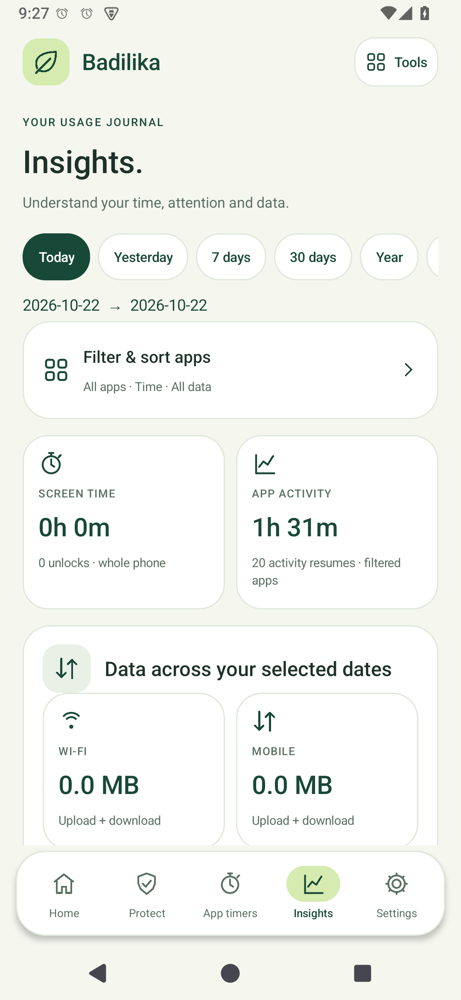

# Badilika

### A little less screen. A little more life.

Free, open-source tools for people who want healthier digital habits: porn and escort domain protection, daily app timers and a private usage journal.

[Website](https://badilika.sparkfield.co.ke) · [Download Android 1.5.2](https://badilika.sparkfield.co.ke/downloads/Badilika-1.5.2.apk) · [Setup guide](https://badilika.sparkfield.co.ke/guide) · [Protection explained](https://badilika.sparkfield.co.ke/protection)


**Free. No ads. No sale of personal data.** Usage history stays on the phone. DNS, list downloads and website hosting use external services as described in the [privacy policy](https://badilika.sparkfield.co.ke/privacy).

## What it does

| Tool | Behavior |
| --- | --- |
| Porn protection | Local adult-domain rules, subdomain matching, validated list updates and Cloudflare Family DNS while enabled. |
| Escort protection | An independently enabled curated escort/adult-classified domain list. |
| Protection cooldowns | Separate disable delays of 1–30 days; wait, then explicitly confirm switching off. |
| Daily app timers | Choose a daily duration using an alarm-style clock and see used/remaining time. |
| Automatic closing | With Usage access and Accessibility, return selected apps to Home at their daily allowance. |
| Timer change cooldowns | Reductions apply immediately; increasing, disabling or removing limits requires a completed wait. |
| Insights | App time, phone activity and Wi-Fi/mobile totals with date filters and local history. |
| Charging clock | Optional analog Android screen saver on supported phones. |
| Setup help | A skippable first-run guide, always available again in Settings, plus FAQ, privacy and terms. |

<p> </p>

Screenshots show an earlier app build; the website identifies them accordingly.

## Install and get started

1. Download the APK on an Android 6+ phone. Badilika is **not yet on Google Play**.
2. Open it and allow installation from your browser or file manager when Android asks.
3. Updating? Install over the existing app to preserve settings and history. Do not uninstall or clear storage.
4. Follow the setup guide, or reopen it through **Settings → Setup guide**.
5. For timers, grant **Usage access** and enable **automatic closing** in Android Accessibility settings.
6. For content protection, enable the desired categories under **Protect** and accept VPN permission.
7. Choose an app, tap its allowance clock, select hours and minutes, choose the change cooldown and save. **00:30 means 30 minutes per day, not a time of day.**

See the [full setup guide](https://badilika.sparkfield.co.ke/guide), [features](https://badilika.sparkfield.co.ke/features) and [rules and limits](https://badilika.sparkfield.co.ke/rules).

## Rules and practical limits

- Daily allowances reset at local midnight and include earlier usage that day. Date/timezone changes can affect reporting.
- Protection stays active during a disable request and until confirmation. Cancel a countdown to keep protection; a later request starts the complete wait again.
- Cooldowns use monotonic elapsed device time. Powered-off time does not count.
- Android settings can revoke permissions, force-stop, clear data or uninstall the app. Badilika is a voluntary tool, not a device-management lock.
- Automatic closing returns an app to Home; it does not force-stop its process. Background playback/downloads can continue.
- Domain filtering is incomplete. It cannot inspect content inside ordinary apps, and cached connections, proxies, competing VPNs and encrypted DNS can bypass it.
- Turn off system Private DNS and browser Secure DNS for best coverage. Only one VPN can run at a time. **Do not enable “Block connections without VPN”** for this DNS-only implementation.
- Network/usage records depend on Android and may be delayed or incomplete. Exact router/provider attribution is unavailable.
- Uninstalling or clearing storage deletes local history. Keep tracking enabled for long-term journal records.

## Project structure and development

- [mobile/](mobile/) — native Java Android app, source, resources, tests and signed-APK build script.
- [desktop/](desktop/) — Windows hosts-file blocker, GUI, safeguards and build scripts. Its behavior differs from Android; see its README.
- [website/](website/) — static product site; shared navigation, footer, imagery and generated routes.
- [CONTRIBUTING.md](CONTRIBUTING.md) — contribution rules, privacy expectations and verification guidance.

Android build and verification instructions are in [mobile/README.md](mobile/README.md). Keep signing keys outside the repository and use the same key for updates.

Website development (Node.js required):

```sh
cd website
node build.mjs
node --check ui.js
```

Edit `pages.mjs` for feature, protection, guide and rules content. `build.mjs` reuses the home page’s header/footer and creates route HTML and the sitemap. Shared styling lives in `style.css` and `modules.css`; `ui.js` handles decorative motion and reading progress. Production pushes run GitHub checks and trigger Vercel deployment of `website/`.

## License, privacy and attribution

Original code: [MIT License](LICENSE). Third-party materials retain their own licenses; MIT does not relicense external blocklists or photography. Forest photograph: [Sebastian Unrau on Unsplash](https://unsplash.com/photos/sp-p7uuT0tw). App screens are project screenshots.

[Privacy policy](https://badilika.sparkfield.co.ke/privacy) · [Terms of use](https://badilika.sparkfield.co.ke/terms)

Badilika is provided as-is. Filtering and timers are not guaranteed to block every access path. It is a wellbeing tool, not medical advice.

